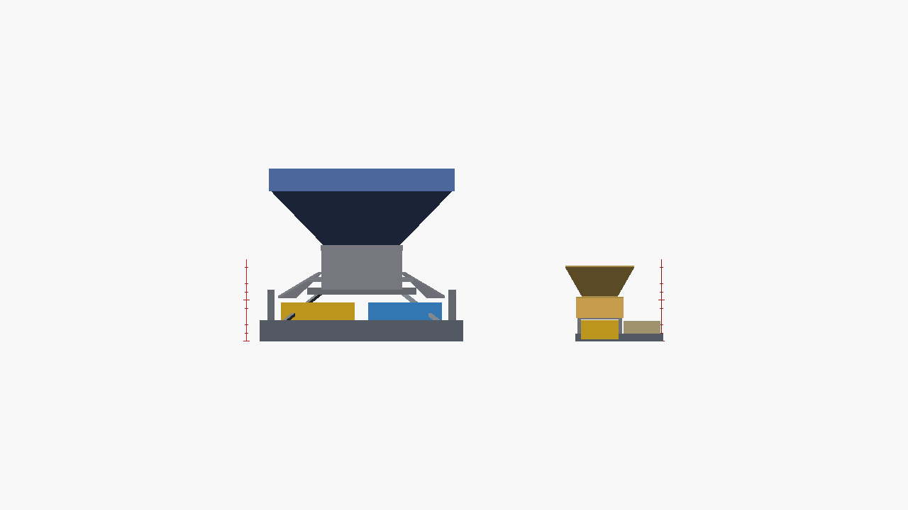

# Micropaleontology dry-sediment splitter (Jones-type)

Compact **Jones micro-riffle** kits for dried sediment, modelled on the classic brass micro-splitter: a small hopper sitting directly on a short A-frame chute block, with cups that slide out from under each side. Every part is a separate print that pins or sockets into the next.

**Design rules (all kits)**

- Whole assembled device, tray to funnel rim: **100 mm maximum** (actual: 92.1 to 94.6 mm).
- Cups are the scale reference: **45 x 39 x 24 mm** (the brass kit cup size).
- The catch tray holds **4 cups** in every kit.
- Mating clearance **0.5 mm** per side (pins 3.0 mm in 4.0 mm holes, cups to frame, plates to tray slots).
- Walls **1.6 mm or more**; chutes and hoppers **45 degrees or steeper**, so all parts print upright with no supports.

| Kit | Split | STLs | OpenSCAD | Height | Footprint |
|-----|-------|------|----------|--------|-----------|
| **2-way** | 1:1 front / back | [`stl/2way/`](stl/2way/) | [`scad/splitter_2way.scad`](scad/splitter_2way.scad) | 92.1 mm | tray 106.5 x 86.2 mm |
| **4-way** | 1:1:1:1, one-piece two-stage riffle | [`stl/4way/`](stl/4way/) | [`scad/splitter_4way.scad`](scad/splitter_4way.scad) | 94.6 mm | 109.0 x 86.2 mm |
| **Cascade** | 1:1:1:1, stages printed separately | [`stl/cascade/`](stl/cascade/) | [`scad/splitter_cascade.scad`](scad/splitter_cascade.scad) | 94.6 mm | 109.0 x 86.2 mm |

Submit the files from **one** folder to your printer. The cup is the same in all three kits.



*Left: the first 2-way print (sized for a 256 mm plate). Right: the compact 2-way. Red posts are 100 mm.*

---

## 2-way (front / back)

```
          [ FUNNEL ]           80 x 56 mm rim, 60 deg walls
          [ RIFFLE ]           8 chutes, alternate chutes lean front / back
     ____/ A-frame  \____
     [A1]    frame    [B1]     cups slide out front and back
     [tray .......... A2 B2]   spares parked beside the riffle
```

8 chutes, each 3.6 mm wide with 1.6 mm vanes (inlet 40.0 x 16 mm). Even chutes drop to cup A1, odd chutes to cup B1, so the split is 1:1. Chute floors slope at 59.7 degrees.

### Print list (2-way)

| Part | Qty | STL | Size (W x D x H, mm) |
|------|-----|-----|----------------------|
| Cup | **4** | `stl/2way/cup.stl` | 45.0 x 39.0 x 24.0 |
| Catch tray (4 cup places) | 1 | `stl/2way/catch_tray.stl` | 106.5 x 86.2 x 9.0 |
| Frame | 1 | `stl/2way/frame.stl` | 54.0 x 81.2 x 29.3 (incl. pins) |
| Riffle | 1 | `stl/2way/riffle.stl` | 57.4 x 48.8 x 26.4 (incl. pins) |
| Funnel | 1 | `stl/2way/funnel.stl` | 84.4 x 60.4 x 40.0 |

### Assemble (2-way)

1. Drop the frame plates into the two slots in the tray floor.
2. Slide cups A1 and B1 in under the frame ties from the front and back, finger notch outward, until they touch the centre rib.
3. Park the two spare cups in the recesses beside the frame.
4. Set the riffle on the frame pins, then the funnel on the riffle pins.
5. Pour; collect halves in A1 and B1. Swap in the spares to re-split.

Stack: tray floor 2.0, cups 24.0, riffle base at 28.1, riffle 24.0, funnel 40.0 = **92.1 mm**. The funnel rim overhangs the tray on the riffle side, so the overall envelope is 119.2 x 86.2 mm.

---

## 4-way (one pour, four equal parts)

```
            [ FUNNEL ]
         [ STAGE 1  L / R ]          8 chutes
        /  hopper   hopper  \        internal collecting hoppers
   [STAGE 2 F/B]      [STAGE 2 F/B]  8 chutes each
    A1     A2           B1     B2    all four cups active
```

The riffle is **one print** that contains both split stages. Stage 1 splits left / right; each half falls through a short internal hopper into a stage-2 bank that splits front / back into a cup. The earlier single-bank 4-way (chutes numbered i % 4 to four corners) could not work without chutes crossing inside the block, so it was replaced by this two-stage layout, which gives a true 1:1:1:1 split.

### Print list (4-way)

| Part | Qty | STL | Size (W x D x H, mm) |
|------|-----|-----|----------------------|
| Cup | **4** | `stl/4way/cup.stl` | 45.0 x 39.0 x 24.0 |
| Catch tray (4 cups) | 1 | `stl/4way/catch_tray.stl` | 109.0 x 86.2 x 9.0 |
| Frame (3 plates) | 1 | `stl/4way/frame.stl` | 104.0 x 81.2 x 29.3 (incl. pins) |
| Riffle, two stages in one | 1 | `stl/4way/riffle.stl` | 107.2 x 53.0 x 51.9 (incl. pins) |
| Funnel | 1 | `stl/4way/funnel.stl` | 40.4 x 64.4 x 17.0 |

The 4-way riffle has an internal flat ceiling of about 21 mm between the two hoppers; it bridges fine in PLA or PETG without supports.

Stack: riffle base 28.1, stage 2 12.0, hopper 14.0, stage 1 23.5, funnel 17.0 = **94.6 mm**.

---

## Cascade (two stages, separate prints)

Same layout and heights as the 4-way, but the stages are separate prints so each one can be cleaned or used on its own.

### Print list (cascade)

| Part | Qty | STL | Size (W x D x H, mm) |
|------|-----|-----|----------------------|
| Cup | **4** | `stl/cascade/cup.stl` | 45.0 x 39.0 x 24.0 |
| Catch tray (4 cups) | 1 | `stl/cascade/catch_tray.stl` | 109.0 x 86.2 x 9.0 |
| Frame (3 plates) | 1 | `stl/cascade/frame.stl` | 104.0 x 81.2 x 29.3 (incl. pins) |
| Lower riffle (stage 2 + hopper) | **2** | `stl/cascade/riffle_lower.stl` | 53.4 x 53.0 x 28.4 (incl. pins) |
| Upper riffle (stage 1) | 1 | `stl/cascade/riffle_upper.stl` | 62.8 x 53.0 x 25.9 (incl. pins) |
| Funnel | 1 | `stl/cascade/funnel.stl` | 40.4 x 64.4 x 17.0 |

### Assemble (4-way and cascade)

1. Drop the frame plates into the three slots in the tray floor.
2. Slide the four cups in from the front and back, finger notch outward.
3. 4-way: set the riffle on the frame pins. Cascade: set the two lower riffles on the outer frame pins (hoppers toward the centre), then the upper riffle on the hopper pins.
4. Set the funnel on the top pins and pour. Quarters collect in all four cups.

---

## Why 8 chutes of 3.6 mm

The brass reference uses 6 to 8 narrow chutes and the cups are only 45 mm wide, so a 12 x 6 mm bank (89 mm wide) would overshoot the cups. 8 chutes of 3.6 mm (40 mm bank) fit inside the 41.8 mm cup opening. 3.6 mm is still more than three times the size of most foraminifera and sand grains in a micropaleontology residue. For coarser material, change `chute_w` in `scad/splitter_lib.scad` and re-check with `scripts/verify_kits.py`.

## Files

- `scad/splitter_lib.scad`: shared parts (cup, chute bank, funnel, frame, tray, fits).
- `scad/splitter_quarter_lib.scad`: shared two-stage geometry for the 4-way and cascade.
- `scad/splitter_2way.scad`, `splitter_4way.scad`, `splitter_cascade.scad`: kit parameters and part selection (`PART = ...`).
- `scad/compare_2way_old_vs_new.scad` and `scad/legacy/splitter_2way_256mm.scad`: the first 256 mm 2-way, kept for the comparison render only. Do not print it.
- `scripts/verify_kits.py`: part sizes, assembled height (must be 100 mm or less), footprint, part overlap and chute-to-cup checks. Needs `pip install trimesh manifold3d rtree`.

## Renders

- `render/<kit>/assembly.png`, `exploded.png`, `side_view.png` (front elevation with a 100 mm post), plus one PNG per part.
- `render/compare_2way_old_vs_new.png`: old and new 2-way side by side at the same scale.

## Print settings (all kits)

- PLA or PETG, 0.20 mm layers, 3 or more perimeters, 20 to 30% infill.
- Print each part upright on its flat base; no supports.
- Clearance between mates is 0.5 mm. Sand lightly if your printer runs large.

```bash
./scripts/build_stls.sh       # all three STL kits
./scripts/build_renders.sh    # PNG previews and the comparison
./scripts/verify_kits.py      # size, height and fit checks
./scripts/build_videos.sh     # orbit + walkthrough MP4s
```

Split accuracy is unverified until tested with your sediment.

## Videos

Rebuilt by `scripts/build_videos.sh` for the compact kits:

- `video/2way_orbit.mp4`, `video/2way_walkthrough.mp4`
- `video/4way_orbit.mp4`, `video/4way_walkthrough.mp4`
- `video/cascade_orbit.mp4`, `video/cascade_walkthrough.mp4`
- Legacy names `video/splitter_3d_orbit.mp4` and `video/two_way_splitter_walkthrough.mp4` are copies of the 2-way clips.

`video/4way_how_it_works.mp4` and `scripts/make_4way_how_it_works.py` describe the earlier single-bank 4-way and are kept for reference only.
